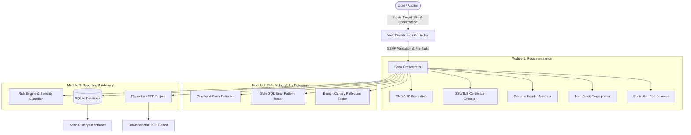

# Web Application Security Testing and Vulnerability Scanner
**Academic Capstone Project in Cybersecurity & Ethical Hacking**

---

## 🛡️ Project Overview
The **Web Application Security Testing and Vulnerability Scanner** is a comprehensive, defensive, dynamic application security auditing platform designed for evaluating websites and web applications. It automates reconnaissance, detects critical web application vulnerabilities (SQL Injection and Cross-Site Scripting), performs risk severity analysis, and generates publication-grade PDF assessment reports.

---

## 🏛️ System Architecture: The Three Main Modules



### Module 1: Website Information Gathering and Reconnaissance
* **Domain & DNS Resolution**: Resolves hostnames to IP addresses with SSRF filtering.
* **HTTP/HTTPS & SSL/TLS Analysis**: Evaluates certificate validity, issuer, cipher suites, protocol versions, and expiration dates.
* **Security Header Audit**: Checks for presence and misconfiguration of OWASP security headers (`Content-Security-Policy`, `Strict-Transport-Security`, `X-Frame-Options`, `X-Content-Type-Options`, `Referrer-Policy`, `Permissions-Policy`).
* **Technology Fingerprinting**: Detects server banners, backend frameworks (PHP, ASP.NET, Django, Flask, Java), and frontend libraries (React, Vue, Bootstrap).
* **Controlled Port Scanning**: Safely probes standard web ports (80, 443, 8080, 8443, 3000, 5000, 8000) using zero-delay non-blocking socket wrappers.

### Module 2: SQL Injection & XSS Vulnerability Detection
* **Ethical & Non-Destructive**: Performs safe, controlled probes without modifying databases, dropping tables, or executing malicious JavaScript.
* **SQL Injection Auditing**: Injects safe syntax boundary characters (`'`, `"`, `1' OR '1'='2`) to analyze whether unhandled database syntax error signatures (MySQL, PostgreSQL, Oracle, SQLite, Microsoft SQL Server) are exposed.
* **Reflected XSS Auditing**: Generates unique, benign canary markers (e.g. `<span id='sec_canary_abc123'>canary_abc123</span>`) to verify whether inputs are echoed into the DOM without context-aware HTML entity encoding.
* **Automatic Deduplication**: Aggregates findings per input parameter to ensure clean, distinct vulnerability records.

### Module 3: Vulnerability Reporting & Security Recommendations
* **Composite Risk Score (0.0 to 10.0)**: Computes weighted severity scores inspired by CVSS v3.1.
* **Severity Classification**: Categorizes vulnerabilities into Critical, High, Medium, Low, and Informational.
* **Technical Evidence & Remediation**: Provides exact line evidence, security impacts, and actionable developer guidance.
* **Executive PDF Report**: Generates professional multi-page downloadable security audit reports with ReportLab.
* **Historical Persistence**: Stores all historical scans and findings in a local SQLite database with quick review and delete capabilities.

---

## 🚀 Installation & Quick Start Guide

### Prerequisites
* Python 3.10 or higher
* Windows, Linux, or macOS

### Step 1: Install Dependencies
Open PowerShell or Command Prompt in the project folder and install dependencies:
```bash
pip install -r requirements.txt
```

### Step 2: Start the Vulnerability Scanner
Launch the Flask backend server:
```bash
python app.py
```
Open your browser and navigate to: **`http://127.0.0.1:5000`**

---

## 🧪 Local Test Lab Demonstration (For Project Presentation)

To safely demonstrate the scanner detecting real vulnerabilities during your college viva or project demo, run the included **VulnLab Test Application**:

### 1. Launch the Test Application
Open a **new, separate terminal** and run:
```bash
python test_vulnerable_app.py
```
The test bench starts at: **`http://127.0.0.1:5050`**

### 2. Run the Security Scan
1. In your browser at `http://127.0.0.1:5000`, enter the target URL:
   ```text
   http://127.0.0.1:5050
   ```
2. Check the **Ethical Authorization Confirmation** box.
3. Click **Launch Security Assessment**.
4. Observe the **Live Assessment Terminal Logs** and real-time progress bar.
5. Once completed, explore the **Vulnerability Findings**, **Reconnaissance Profile**, and click **Download PDF Report**.

---

## 📂 Project Directory Structure

```text
Capstone/
│
├── app.py                      # Main Flask application and API endpoints
├── config.py                   # Central settings, SSRF policies, timeouts
├── requirements.txt            # Python dependencies
├── README.md                   # Complete academic documentation & guide
├── test_vulnerable_app.py      # Authorized local demonstration target (Port 5050)
│
├── database/
│   ├── __init__.py
│   ├── schema.sql              # Relational SQLite schema definition
│   └── db_manager.py           # Database CRUD operations
│
├── modules/
│   ├── __init__.py
│   ├── http_client.py          # Unified session and safe request client
│   ├── scanner_orchestrator.py # Threaded assessment pipeline manager
│   │
│   ├── module1_recon/
│   │   ├── __init__.py
│   │   ├── cert_checker.py     # SSL/TLS validation & cipher inspection
│   │   ├── header_analyzer.py  # Security headers analyzer (OWASP)
│   │   ├── tech_detector.py    # Framework & server fingerprinter
│   │   ├── port_scanner.py     # Fast TCP web port profiler
│   │   └── recon_engine.py     # Module 1 coordinator
│   │
│   ├── module2_detection/
│   │   ├── __init__.py
│   │   ├── crawler.py          # Form and parameter discovery engine
│   │   ├── sqli_detector.py    # Safe SQL error pattern tester
│   │   ├── xss_detector.py     # Benign canary reflection tester
│   │   └── vuln_engine.py      # Module 2 coordinator & deduplicator
│   │
│   └── module3_reporting/
│       ├── __init__.py
│       ├── risk_engine.py      # Composite risk scoring (0-10 scale)
│       └── pdf_generator.py    # Professional ReportLab PDF builder
│
├── reports/                    # Generated PDF audit reports
│   └── scan_report_*.pdf
│
├── static/
│   ├── css/
│   │   └── style.css           # Cybersecurity dark theme
│   └── js/
│       └── dashboard.js        # AJAX polling & real-time terminal UI
│
├── templates/
│   ├── base.html               # Main template layout
│   ├── index.html              # Scan launcher & live progress terminal
│   ├── scan_results.html       # Module-wise detailed results viewer
│   ├── history.html            # Scan history log table
│   └── 404.html                # Error page
│
└── tests/
    └── test_scanner.py         # Automated end-to-end integration test
```

---

## 🔒 Ethical Compliance & SSRF Safeguards
* **SSRF Prevention**: By default, `config.py` enforces restrictions against scanning unauthorized private subnets, loopbacks, and cloud metadata endpoints (`169.254.169.254`). For isolated college demonstrations, `ALLOW_LOCAL_TESTING = True` allows testing on localhost (`127.0.0.1`).
* **Non-Destructive Testing**: Probes only look for syntax errors and canary reflection; no queries execute `DROP`, `DELETE`, or extraction of user records.
